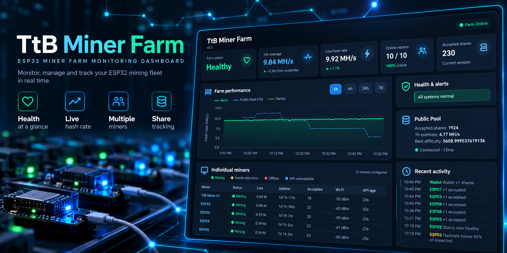
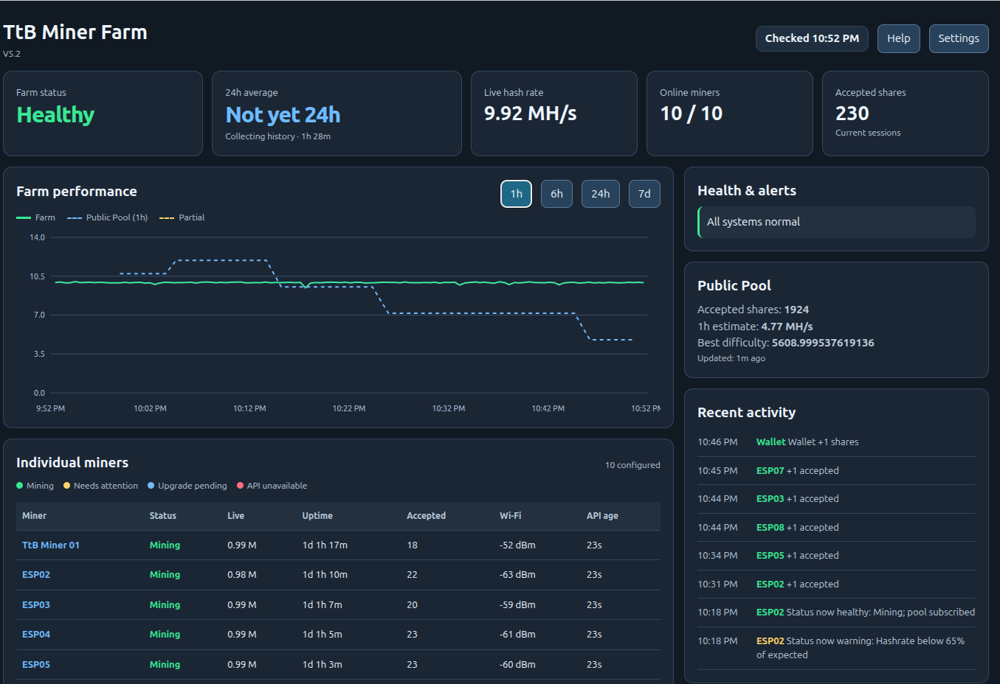
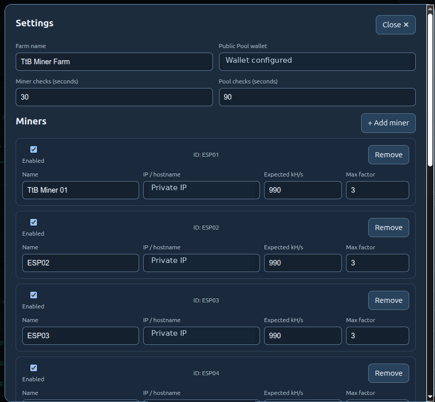

# TtB Miner Farm



*Promotional illustration; actual interface screenshots below.*

**A lightweight, self-hosted dashboard for ESP32 Bitcoin lottery miners.**

Track your miners from a Raspberry Pi or other Linux computer: see who's online, compare live hashrates, watch shares arrive, and review your farm's history from a desktop or phone. No USB cables or serial monitoring required.

**Current release:** [V5.2 RC1](https://github.com/FrankM36/ttb-miner-farm/releases/tag/v5.2.0-rc1) · **License:** MIT · **Runtime:** Python 3 standard library + SQLite



*Live farm overview: miner health, hashrate history, share activity, and an independent Public Pool estimate.*

<details>
<summary>See the Settings screen</summary>



</details>

## What it does

- **Monitor multiple miners** — live hashrate, uptime, API availability, Wi-Fi signal, and mining status.
- **Track your farm** — combined hashrate, rolling history, and firmware-reported accepted shares.
- **Compare with Public Pool** — see a separate, share-derived pool estimate when configured.
- **Catch problems** — flag offline miners, restarts, reconnects, and implausible hashrate readings.
- **Customize in the browser** — rename the farm and miners, add or disable miners, and update addresses and polling intervals.
- **Keep the data local** — SQLite history and a JSON configuration file on your own computer.
- **Check from your phone** — responsive dashboard on your local network or a private VPN such as Tailscale.

## Compatibility

Tested with **HenrysCat NerdMiner-Modded V1.5.0** on ESP32 devices exposing a JSON status endpoint at:

```text
http://MINER_IP/api/status
```

Other firmware versions and miner projects are **not yet verified**. TtB Miner Farm monitors existing miners; it does not flash firmware or configure an ESP32's Wi-Fi, pool, or wallet credentials.

## Quick start

You'll need Python 3, a Raspberry Pi or other Linux machine on the same network as your miners, and at least one compatible miner.

```bash
git clone https://github.com/FrankM36/ttb-miner-farm.git
cd ttb-miner-farm
cp config.example.json farm_config.json
python3 setup_admin_key.py
python3 ttb_miner_farm_v5.py --config farm_config.json --db miner_farm.sqlite3 --port 8081 --admin-key-file admin_key.txt
```

Then open `http://YOUR_PI_IP:8081` in a browser. Choose **Settings** to enter your own miner IP addresses, descriptive names, and Bitcoin wallet. To save changes, use the private key created in `admin_key.txt` on the Pi. **Never upload that file or share the key.**

> **Network safety:** The dashboard serves ordinary HTTP by default and has no viewer login. Keep it on a trusted LAN or private VPN. Do **not** forward its port to the public internet. If entering your admin key remotely, access the Pi through a secure private connection such as Tailscale, or use HTTPS through a properly configured proxy.

### Example configuration

`config.example.json` is a template with fictional miner addresses. Your local `farm_config.json` is where settings are stored and is excluded from Git.

The browser Settings editor lets you change:

- Farm title and Bitcoin wallet address
- Each miner's display name, IP/hostname, and enabled state
- Expected hashrate and outlier threshold
- Miner and pool polling intervals

Miner **IDs** remain stable when display names change, so renaming a miner does not split its stored history. Saves are validated, written atomically, and backed up automatically.

## Reading the dashboard

| Indicator | Meaning |
| --- | --- |
| **Live hashrate** | Sum of the current valid miner-reported speeds |
| **Farm history (green)** | Measured combined hashrate over time |
| **Partial data (yellow)** | Samples when some miner APIs did not respond |
| **Public Pool (blue dashed)** | Independent estimate based on pool share data; can differ from instantaneous speed |
| **Accepted shares** | Miners' firmware session counters; these reset when miners reboot |

The 24-hour farm average appears after enough valid historical readings have accumulated. Implausible outliers are excluded from the displayed farm rate while historical records are retained.

## Security and privacy

- **Don't commit:** `admin_key.txt`, `farm_config.json`, configuration backups, SQLite databases, or logs. `.gitignore` excludes these by default.
- The Settings page requires an administrator key **to save changes**. Dashboard viewing itself is not password-protected.
- A secure network connection matters: an admin key does not encrypt HTTP traffic.
- Changes made here affect **the monitoring software**, not the firmware configuration on each miner.

## Run automatically on Linux

For an always-on installation, use a `systemd` service that runs the same command as the Quick start section, with absolute paths to your project directory, config, database, and admin-key file. Enable the service only after you've confirmed the application starts correctly. Keep the SQLite database somewhere persistent and backed up.

## Tests

```bash
python3 -m unittest discover -s tests -v
```

The included tests cover miner monitoring, impossible-hashrate filtering, stable miner identity, configuration validation, backups, write protection, and edit conflicts.

## Project status

**V5.2 RC1 is a release candidate**, tested with a ten-miner ESP32 farm. Feedback, bug reports, and compatibility information are welcome in [GitHub Issues](https://github.com/FrankM36/ttb-miner-farm/issues).

This software is for *lottery-mining monitoring*, not a promise of finding Bitcoin blocks. Mining outcomes are random and a valid block candidate should be independently verified.

## Acknowledgments

Developed by **TtB**. Built around the HTTP status API provided by [HenrysCat's NerdMiner-Modded firmware](https://github.com/HenrysCat). This is an independent monitoring project, not an official firmware component.

Released under the [MIT License](LICENSE).
